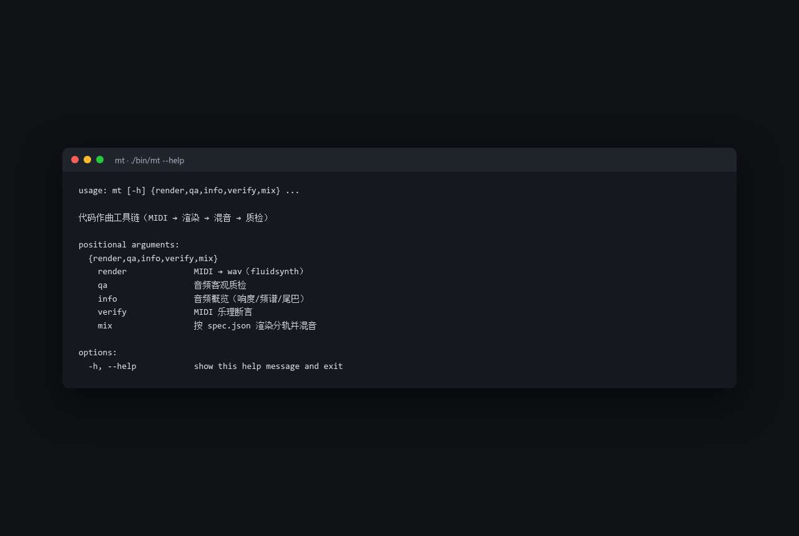

# mt · 代码作曲工具链

用**代码写每个音**，而不是用提示词碰运气：MIDI 写入/校验 → fluidsynth 渲染 → 分轨混音 → 客观质检。
四段流水线，每段都能单独用。



## 为什么是「代码作曲」

AI 生成器在精确控制上不可靠。这套工具的立场是：**旋律、和声、节拍、每个音的时值由人决定**；音色交给 GM 音源，混音交给可复现的处理链。做到这一步之后，「这个音对不对」才是一个能被讨论、能被复查的问题。

```
midi.py     写谱（零依赖 SMF 写入器 + 独立读取器）
   ↓
verify.py   渲染前就能判死：音域 / 同音粘连 / 和声 / 力度
   ↓
render.py   fluidsynth + SoundFont → 可复现的波形
   ↓
mix.py      逐轨实测音量 → 滤波 → 声像 → 卷积混响 → 段落增益 → LUFS 归一
   ↓
analyze.py  只听数字的质检：削波 / 爆音 / 真空 / 动态弧线 / 频谱
```

## 快速开始

不需要安装（系统 Python 有 PEP 668 保护，我们不碰它）：

```bash
./bin/mt --help
```

或者直接用包：

```python
import sys; sys.path.insert(0, "path/to/music_toolkit")
from mt import Score, Mixer, report
from mt.midi import GM

s = Score(title="demo")
s.tempo(1, 90).marker(1, "A 段")
piano = s.voice("piano", channel=0, program=GM["acoustic_grand"])
piano.chord(1, 1, 3.5, ["A3", "E4", "A4"], vel=64)
piano.note(1, 3, 1.0, "E5", vel=72)
```

跑一遍完整示例（作曲 → 断言 → 渲染 → 混音 → 质检）：

```bash
cd examples && python3 01_piano_cello.py
```

## CLI

```bash
mt render    # MIDI → wav（fluidsynth）
mt qa        # 音频客观质检
mt info      # 音频概览（响度/频谱/尾巴）
mt verify    # MIDI 乐理断言
mt mix       # 按 spec.json 渲染分轨并混音
```

## 依赖

- Python ≥ 3.10，`numpy`、`scipy`（pip 安装即可）
- `fluidsynth` 可执行文件、`ffmpeg`、一个 SoundFont
- 默认找 `music/_soundfonts/MuseScore_General.sf3`，也可用 `MT_SOUNDFONT` 环境变量指定

> 只有渲染/混音需要 fluidsynth 和 SoundFont；写谱、校验、质检的纯逻辑部分不需要。

## 测试

```bash
python3 -m pytest tests -q
```

## 项目结构

```
.
├── bin/mt              # 命令行入口
├── mt/
│   ├── midi.py         # SMF 写入器 + 读取器
│   ├── verify.py       # 乐理断言
│   ├── render.py       # fluidsynth 渲染
│   ├── mix.py          # 分轨混音
│   ├── analyze.py      # 音频质检
│   └── cli.py          # 命令行
├── examples/           # 可运行的完整示例
├── tests/              # pytest 单元测试
└── pyproject.toml
```

## 设计取舍

- **零依赖的 MIDI 读写**：不引入 mido 之类的库，SMF 格式自己写自己读，保证字节级可控。
- **可复现**：同一份谱 + 同一个 SoundFont，渲染和混音结果确定，方便对比不同编曲版本。
- **客观质检**：响度、削波、频谱、动态弧线都量化成数字，而不是「听起来还行」。

## License

MIT © 2026 FallWind71
